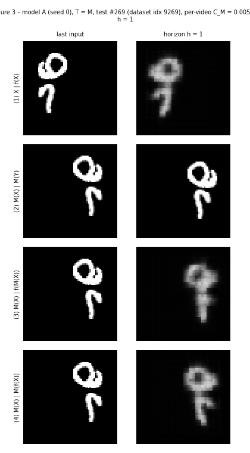
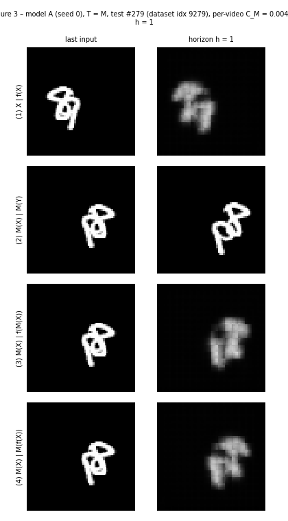
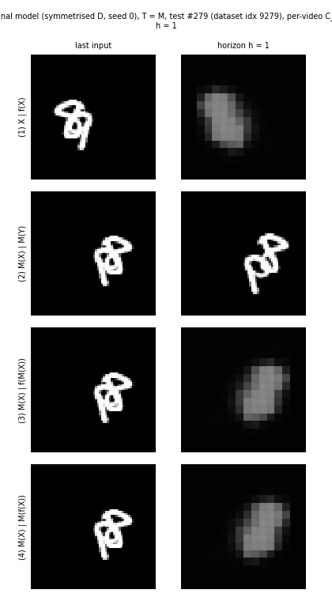
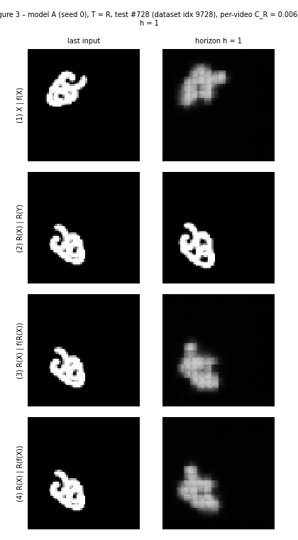
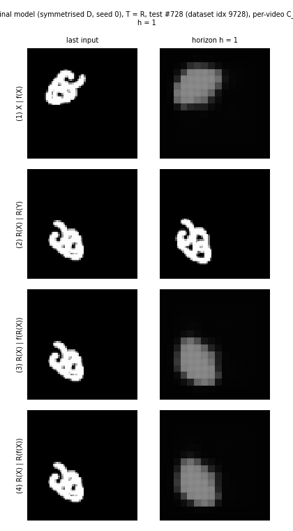
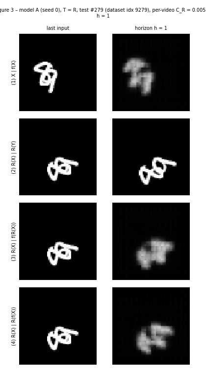
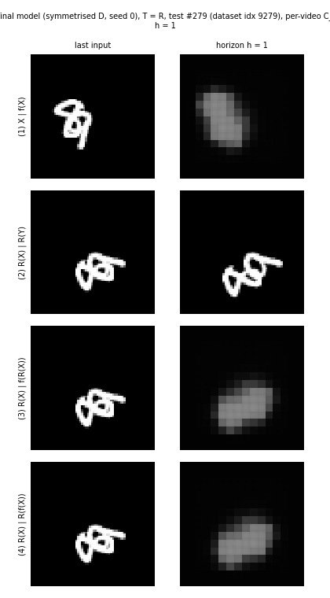

# AI651 PA2 — Deep Learning for Space Time Graph, Assignment 2

**Mubeen Ahmed (25280101), Fall 2026**

This repository holds the code, notebooks and results for **Question 2, "Motion or Memory?"**: a
ConvLSTM that forecasts 5 future Moving MNIST frames from 5 inputs, stress-tested with three probes:
- mirror and rotation consistency;
- playback at 2× and 3× speed;
- data augmentation (models B–D) and symmetrised forecasters.

Question 1 (the river forecasting proposal) is a written design with no code; it is in the report,
`25280101_mubeen_ahmed_DL4STG_assignment2.pdf`. AI assistance is disclosed at the end of the report.

## Main results

Test split (1,000 videos), t = 1, mean of seeds 0 and 1. The full tables, with both seeds,
transformed errors and timings, are in [`tables/`](tables).

| Model | E(5) 1× | C_M | C_R | E(2) 1× | E(2) 2× | E(2) 3× | Params |
|---|---|---|---|---|---|---|---|
| Blank | 0.0426 | 0 | 0 | 0.0426 | – | – | 0 |
| Copy-last | 0.0641 | 0 | 0 | 0.0548 | 0.0661 | 0.0703 | 0 |
| A (baseline) | 0.0222 | 0.00199 | 0.00322 | 0.0188 | 0.0453 | 0.0530 | 480,784 |
| B (symmetry aug.) | 0.0217 | 0.00131 | 0.00158 | 0.0182 | 0.0435 | 0.0473 | 480,784 |
| C (speed aug.) | 0.0265 | 0.00144 | 0.00277 | 0.0232 | 0.0286 | 0.0333 | 480,784 |
| D (larger reach + speed aug.) | 0.0273 | 7.71e-04 | 0.00184 | 0.0245 | 0.0290 | 0.0327 | 480,784 |
| symmetrised B | 0.0211 | 8.56e-17 | 6.89e-17 | 0.0178 | 0.0427 | 0.0460 | 480,784 |
| **symmetrised D (final)** | 0.0273 | 6.12e-17 | 4.71e-17 | 0.0246 | 0.0290 | 0.0327 | 480,784 |

What the results show:
- **Baseline.** Model A halves Blank's error at 1× and is only approximately consistent under mirror
  and rotation, with rotation the harder of the two.
- **Speed.** Model A breaks down already at 2×, although 2× motion (≈6.6 px/frame) is within its
  8 px one-step reach.
- **Symmetry augmentation (B)** closes most of the rotation gap, so that gap came from unfamiliar
  appearance.
- **Speed augmentation (C)** fixes most of the speed failure without changing the architecture. The
  larger reach (D) adds only 2% at 3×, so the speed failure was mainly unfamiliar motion, not reach.
- **Symmetrisation (eq. 7)** makes the mirror and rotation gaps exactly zero, up to floating-point
  error, at about 8× the inference cost.

## Animated GIFs

Each GIF steps through the five forecast horizons. The four rows are X | f(X), T(X) | T(Y),
T(X) | f(T(X)) and T(X) | T(f(X)). Click a thumbnail to open the GIF.

| Video | Figure 3 (model A) | Figure 6(a) (final model) |
|---|---|---|
| test #269, mirror, rank 1 | <a href="gifs/fig3_M_rank1_test269.gif"></a> | <a href="gifs/fig6a_M_rank1_test269.gif"></a> |
| test #279, mirror, rank 2 | <a href="gifs/fig3_M_rank2_test279.gif"></a> | <a href="gifs/fig6a_M_rank2_test279.gif"></a> |
| test #728, rotation, rank 1 | <a href="gifs/fig3_R_rank1_test728.gif"></a> | <a href="gifs/fig6a_R_rank1_test728.gif"></a> |
| test #279, rotation, rank 2 | <a href="gifs/fig3_R_rank2_test279.gif"></a> | <a href="gifs/fig6a_R_rank2_test279.gif"></a> |

Test #i is dataset index 9000 + i.

## Pre-registered predictions

The handout requires the Q2.5 and Q2.11 predictions to be committed before the corresponding
experiments. The commit history shows the order:

| Prediction | File | Commit | Committed before |
|---|---|---|---|
| Q2.5 | [`predictions/Q2_5.md`](predictions/Q2_5.md) | `26602eb`, 21 Oct 2026 20:43 (UTC+5) | notebook 3 (mirror, rotation and speed tests; results in `98241b2`) |
| Q2.11 | [`predictions/Q2_11.md`](predictions/Q2_11.md) | `58327bc`, 21 Oct 2026 21:13 (UTC+5) | notebook 4 (training B–D; results in `d711a30`) |

Both files are reproduced unedited in the report, including the parts that turned out to be wrong.

## Repository layout

```
pa2/            code: data, models, training, evaluation, figures, tables
notebooks/      the five Colab notebooks, with outputs, run in order 1 -> 5
predictions/    Q2_5.md and Q2_11.md
figures/        Figures 1-6 and training curves (PNG)
gifs/           GIFs for Figures 3 and 6(a)
tables/         Tables 1-6 and the model-D pilot comparison (.md and .csv)
results/        cached per-video metrics, chosen example videos, model-D choice, Figure 1 stats
```

The `pa2/` package is organised as follows:
- `config.py`: protocol constants and the model registry.
- `data.py`: loading, the manual split, windows, mirror/rotation and the group G.
- `models.py`: the ConvLSTM, Blank, Copy-last and the symmetrised wrapper.
- `train.py`: the resumable training loop.
- `evaluation.py`: the metrics and inference timing.
- `checks.py`: Table 1 and Figure 1.
- `visuals.py`: the figures and GIFs.
- `tables.py`: the table builders.
- `pipeline.py` and `utils.py`: glue code and helpers.

The notebooks are:
1. `PA2_Q2_1_setup.ipynb`: data, Table 1, model A parameter check, Figure 1.
2. `PA2_Q2_2_baseline.ipynb`: trains model A (seeds 0 and 1); Table 2 and Figure 2.
3. `PA2_Q2_3_testing_baseline.ipynb`: Tables 3–4, Figures 3–5 and the Figure 3 GIFs.
4. `PA2_Q2_4_what_data_can_fix.ipynb`: model-D selection on validation; trains B, C and D; Table 5.
5. `PA2_Q2_5_final_model.ipynb`: symmetrised models, Table 6, Figure 6 and its GIFs.

The dataset and model checkpoints are not in the repository. The notebooks download the data and
retrain or reload the models as needed.

## Model D

Model D is identical to model A except that the second ConvLSTM layer's 3×3 convolution is dilated
by 2. Dilation adds no weights, so it has 480,784 trainable parameters, within the 721,176 limit. Its
one-step reach is 12 px along a row or column, against 8 px for model A (calculation in the report,
Q2.12).

It was chosen on the validation split from three candidates trained for 10 epochs: 5×5 kernels, the
dilated design and 8×8 patches (see `tables/pilot_D_validation.md`). Only the dilated design started
to learn within those 10 epochs. The 5×5 candidate's first five pilot epochs ran on a CPU runtime,
so its pilot time per epoch is not meaningful.

## Reproducing the results (Google Colab)

1. Zip the code: `zip -r pa2_code.zip pa2`.
2. Upload the notebooks to Colab and select **Runtime → Change runtime type → T4 GPU**.
3. Run the first cell of notebook 1. It mounts Google Drive and asks for `pa2_code.zip` once. The
   code is kept in `MyDrive/AI651_PA2/code/`, and later notebooks import it from there.
4. Run notebooks 1–5 in order. The first data load downloads Moving MNIST (~800 MB) to Drive.
   Notebooks 3 and 4 only start once the Q2.5 and Q2.11 flags in their second cells are set to True.

Every run checkpoints to Drive at the end of each epoch and every 5 minutes inside an epoch. After a
disconnect, re-run the notebook from the top. Finished runs and computed metrics are loaded from
Drive, and interrupted runs resume exactly where they stopped.

On a T4, each 30-epoch run takes about 5.5 minutes for models A, B and C and about 8 minutes for
model D.

## Measurement definitions

- **Splits:** by dataset index, 0–7,999 train, 8,000–8,999 validation and 9,000–9,999 test. The
  built-in `split=` option is never used.
- **Training time per epoch:** the mean over 30 epochs of the time spent in training batches (data
  preparation, forward, backward and optimiser step). Checkpoint writes to Drive and the validation
  monitor are excluded.
- **Inference time:** all 1,000 original (1×, t = 1) test videos at batch size 32, under `eval()`
  and `no_grad()`, timed from when each batch is on the GPU, after one untimed warm-up batch. For
  symmetrised models it includes all 8 transformations, forward passes, inverse transformations and
  the averaging.
- **Hardware:** all timed runs used a Tesla T4 (15 GB) with PyTorch 2.11.0+cu130.
- **Choosing example videos:** digits translate rigidly and are combined with a pixel-wise max, so a
  drop in a frame's bright-pixel count marks overlapping digits. This is used to pick the videos for
  Figures 2 and 5.
